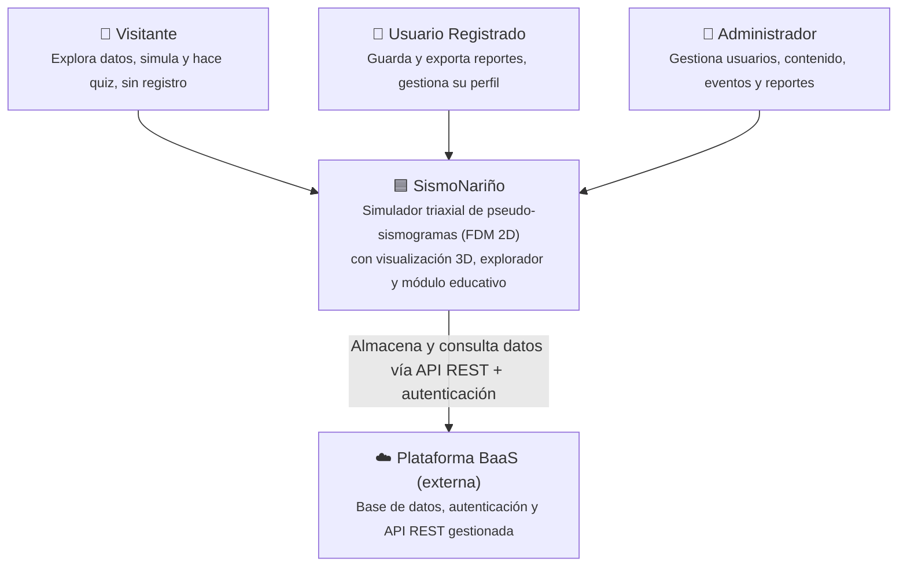
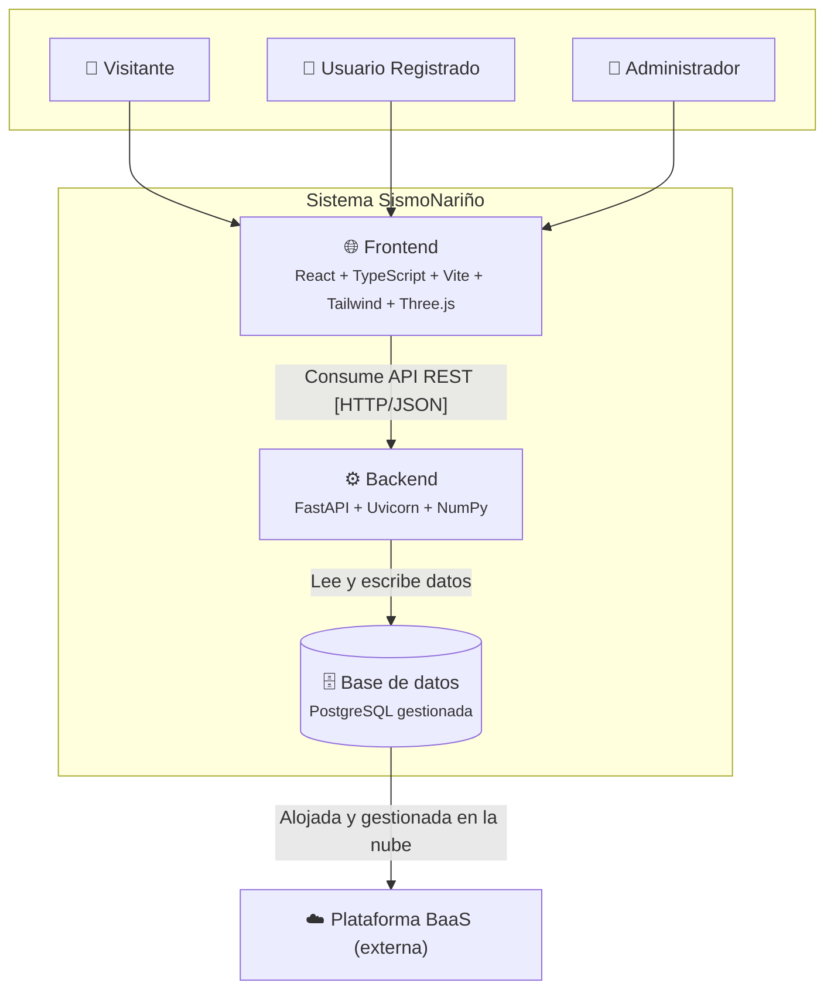
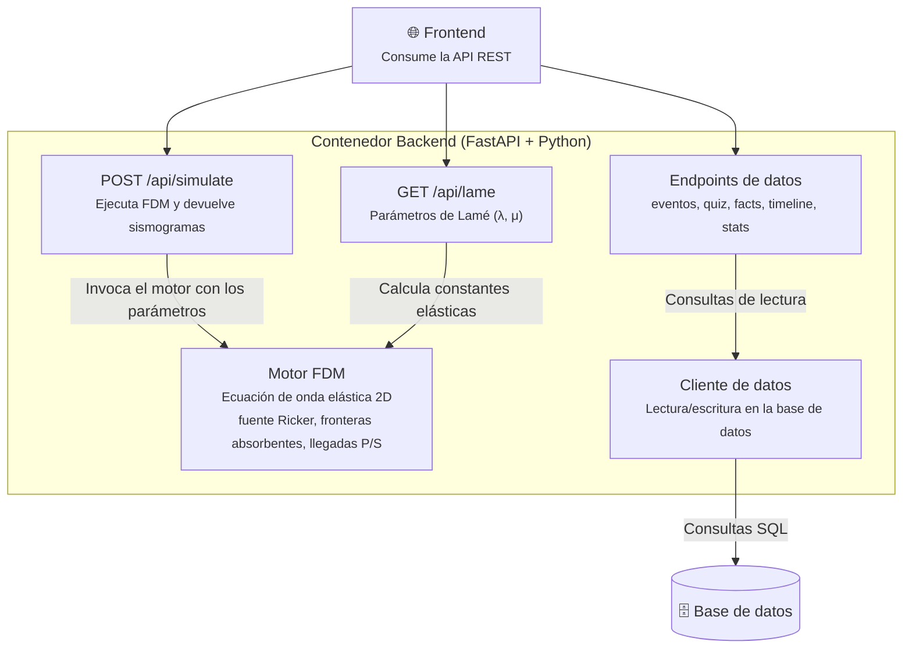

# Arquitectura

La arquitectura se describe con el **modelo C4** en tres niveles: contexto,
contenedores y componentes del backend. Los diagramas se dibujan con **Mermaid**
a partir del modelo original en Structurizr DSL.

!!! note "Archivo fuente del modelo"
    El modelo C4 completo (Structurizr DSL), incluida la vista de componentes del
    frontend, está disponible para descarga:
    [**arquitectura.dsl**](arquitectura.dsl){ download="arquitectura.dsl" }.

## Nivel 1 — Contexto

Quiénes usan la plataforma y con qué sistema externo se integra.

## Nivel 2 — Contenedores

Las piezas desplegables del sistema y cómo se comunican.

## Nivel 3 — Componentes del backend

Los componentes internos del contenedor **Backend** y sus dependencias.

## Qué se simplificó respecto al modelo original

Los diagramas Mermaid de arriba son una versión condensada del modelo
`arquitectura.dsl`. Para que sean legibles en la web se aplicaron estos ajustes:

- **Nivel de contexto:** sin cambios de fondo. Se conservan las tres personas
  (Visitante, Usuario Registrado, Administrador), el sistema SismoNariño y el
  sistema externo. El nombre comercial del proveedor externo se reemplazó por la
  etiqueta genérica «Plataforma BaaS (externa)» para no publicar servicios ni
  URLs internas.
- **Nivel de contenedores:** sin cambios estructurales. Se mantienen los tres
  contenedores (Frontend, Backend, Base de datos) y sus relaciones. Se omitieron
  los detalles de puerto y región que aparecen en el DSL por ser información de
  despliegue interna.
- **Nivel de componentes (backend):** **simplificado.** El DSL enumera cada
  endpoint por separado (`/api/events`, `/api/events/{id}`, `/api/quiz`,
  `/api/wave-facts`, `/api/timeline`, `/api/stats`). Aquí se agruparon en un solo
  nodo «Endpoints de datos» para no saturar el diagrama; el detalle de cada ruta
  está en la sección **API** y en la *Referencia del código*. Se conservan como
  nodos propios la simulación (`/api/simulate`), el cálculo de Lamé
  (`/api/lame`), el motor FDM y el cliente de datos.
- **Alcance:** el modelo original incluye además una **vista de componentes del
  frontend** (App, páginas, paneles de simulación, componentes educativos,
  worker, etc.). No se reprodujo como Mermaid aquí porque pertenece al frontend;
  queda disponible completa en el archivo `arquitectura.dsl` descargable y la
  estructura del frontend se documenta en su propia sección.
- **Evolución del backend:** el DSL refleja el conjunto de endpoints inicial. El
  backend actual incorpora además rutas del Mapa 3D (estaciones, tiempos de
  viaje, sismogramas sintéticos, formas de onda), importación QuakeML, carga de
  MiniSEED y buzón de contacto. Esas rutas no están dibujadas en el diagrama de
  componentes para mantenerlo fiel al modelo original, pero sí están
  documentadas en la *Referencia del código* y en la sección **API**.
