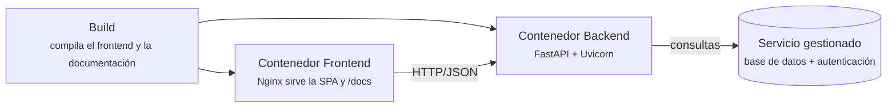

# Despliegue

Esta página describe, en términos generales, cómo se publica la plataforma. No
incluye nombres de variables secretas, claves, direcciones internas ni correos:
las credenciales se gestionan como **variables secretas configuradas en el
servidor** y nunca forman parte de esta documentación ni del repositorio.

## Objetivo

El sistema es portable y contenedorizable: se puede desplegar con **Docker** en
cualquier proveedor que ejecute contenedores. El objetivo de diseño es un
despliegue completo en poco tiempo, con una verificación sencilla al final.

## Piezas que se despliegan

El despliegue consta de tres piezas:

1. **Frontend.** Aplicación web estática servida por un servidor web (Nginx)
   dentro de un contenedor. Se compila en el paso de *build* y luego se sirve.
2. **Backend.** API REST (FastAPI + Uvicorn) en su propio contenedor. El
   proveedor inyecta el puerto de escucha mediante una variable de entorno.
3. **Base de datos y autenticación.** Servicio gestionado en la nube (modelo
   *Backend as a Service*): base de datos relacional, autenticación y API REST
   automática.

## Configuración por entorno

La configuración se pasa por **variables de entorno**. Se distinguen dos tipos:

- **Variables genéricas de configuración.** Determinan el comportamiento del
  despliegue. Por ejemplo:
    - El **modo de ejecución**. En *producción* se endurece el servicio: se
      restringe el origen de las peticiones (CORS), se ocultan los detalles de
      error y se deshabilita la documentación interactiva de la API
      (`/docs`, `/redoc`, `/openapi.json`), que solo queda disponible en
      desarrollo.
    - El **origen del backend**, que el frontend necesita para construir su
      política de seguridad de contenido y saber a qué URL llamar.
- **Variables secretas.** Credenciales del servicio gestionado y secretos de
  firma. Se configuran directamente en el panel del servidor o proveedor, no se
  versionan y no aparecen en esta documentación.

!!! warning "Modo producción"
    En desarrollo, la documentación interactiva de la API queda disponible para
    inspeccionar los endpoints. En **producción** se deshabilita a propósito; la
    referencia de la API que se publica en esta web es una copia **estática y de
    solo lectura**, sin capacidad de ejecutar peticiones.

## Verificación posterior

Una vez desplegado, conviene comprobar al menos:

- El *health check* del backend responde correctamente.
- En producción, la documentación interactiva de la API no está accesible.
- La página de inicio carga con rapidez.
- El inicio de sesión funciona.
- Se puede ejecutar una simulación y descargar su reporte.

El detalle operativo concreto (proveedor, pasos del panel y valores de las
variables) se mantiene fuera de esta documentación pública por seguridad.
